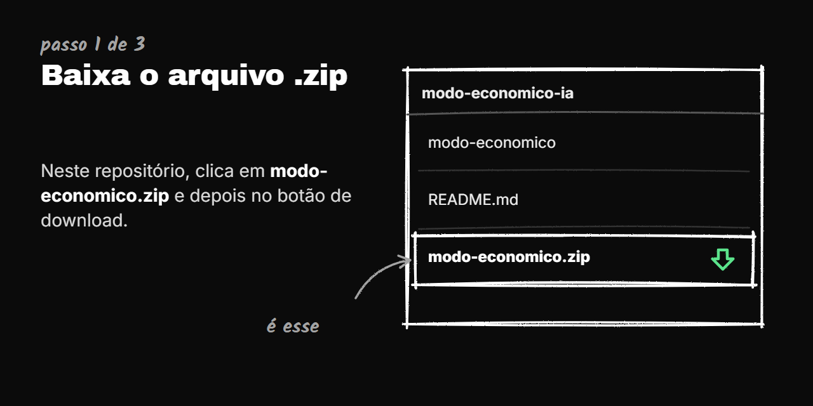

<a id="topo"></a>

<p align="center">
  
</p>

# Modo econômico pra IA

**Uma Skill pro Claude que faz o seu limite render mais.**<br>
Resposta enxuta, pergunta antes do textão, sugere o modelo certo e resume pra trocar de conversa.

Claude (Skill) · ChatGPT e Gemini (instrução fixa) · grátis e pago

**[↓ BAIXAR A SKILL](modo-economico.zip)** · **[→ COMO INSTALAR](#01--instalar)** · **[→ SEM PLANO PAGO](#02--sem-plano-pago)** · **[↗ @DANIELMOURAO.IA](https://www.tiktok.com/@danielmourao.ia)**

---

## 00 / O que ela faz

| | O que muda na prática |
|---|---|
| **Resposta enxuta** | Sem introdução, sem repetir a pergunta, sem resumo no fim. |
| **Pergunta antes do textão** | Até 3 perguntas sobre o que falta, antes de escrever algo longo. |
| **Modelo certo** | Sugere rápido, dia a dia ou mais forte pra cada tarefa. |
| **Troca de conversa** | Resumo de 5 linhas pra abrir conversa nova sem perder nada. |

> **Por que funciona:** a cada mensagem nova, a IA relê a conversa inteira. Menos ida e volta e conversa mais curta gastam menos limite.

---

## 01 / Instalar

Pra quem tem **Claude pago**. Leva uns 2 minutos.

**1. Baixa o arquivo.** Clica em [`modo-economico.zip`](modo-economico.zip) e depois no botão de download.



**2. Liga a execução de código.** No Claude: **Configurações → Recursos** e liga **Executar código na nuvem**.


**3. Envia a Skill.** **Configurações → Skills → Adicionar → Fazer upload de Skill** e escolhe o `modo-economico.zip`.


| Pra usar | Escreve |
|---|---|
| **Ligar o modo** | `modo econômico` |
| **Trocar de conversa** | `resume pra trocar de conversa` |

> **Importante:** a Skill entra quando o pedido combina com ela, não em toda conversa. Pra valer sempre, cola também o texto da seção 02 em **Configurações → Conta → Instruções para o Claude** (no menu novo: **Your Claude → Instruções**).

---

## 02 / Sem plano pago

Cola este texto nas instruções fixas do seu app. Cabe nos 1.500 caracteres do ChatGPT grátis.

| App | Onde colar |
|---|---|
| **ChatGPT** | Configurações → Personalização → Instruções personalizadas |
| **Claude** | Configurações → Conta → Instruções para o Claude (no menu novo: Your Claude → Instruções) |
| **Gemini** | Configurações → Inteligência Personalizada → Instruções para o Gemini |

```text
Modo econômico: quero que meu limite de IA renda mais.
1. Responda curto e direto. Sem introdução, sem repetir minha pergunta e sem resumo no fim. Se eu quiser mais, eu peço.
2. Antes de texto longo, plano ou documento, faça até 3 perguntas sobre o que falta (pra quem é, objetivo, formato). Se já tiver tudo, faça direto.
3. Se eu pedir variações, mande todas numa resposta só, numeradas.
4. Se eu disser que vou mandar um documento, me diga qual trecho você precisa.
5. Na 1ª resposta da conversa e quando o tipo de tarefa mudar, comece com: "Modelo sugerido: [rápido, dia a dia ou mais forte], porque [motivo curto]." Na dúvida, sugira o mais simples.
- Rápido: tarefa curta (e-mail, legenda, resumo). ChatGPT: Instant. Claude: Haiku ou Sonnet.
- Dia a dia: comparar, revisar, planilha, texto maior. ChatGPT: Think ou Medium. Claude: Opus (no grátis, Sonnet).
- Mais forte: problema sem caminho claro ou plano grande do zero. ChatGPT: High ou Extra High (no grátis, Think). Claude: Fable (no Pro, só com crédito extra; sem crédito, Opus).
6. Se a conversa ficar longa ou mudar de assunto, me ofereça um resumo de 5 linhas pra eu abrir uma conversa nova.
```

> **Quem troca o modelo é você:** a IA só sugere o nível pela tarefa. A troca é no seletor de modelo do app.

---

## 03 / O que tem aqui

```text
modo-economico-ia/
├── modo-economico/
│   └── SKILL.md          a Skill: texto puro, sem código, sem acesso à internet
├── modo-economico.zip    a mesma Skill, pronta pra enviar no Claude
└── assets/               imagens deste README
```

> **Segurança:** é um arquivo de texto só. Dá pra abrir o `SKILL.md` e ler tudo antes de instalar.

---

<p align="center">
  <b>MENOS IDA E VOLTA. MAIS LIMITE SOBRANDO.</b><br><br>
  Menus conferidos no Claude em português em 17/11/26. Se o nome mudar, procura "Skills" nas Configurações.<br>
  Material <b>LIMITE</b> · <a href="https://www.tiktok.com/@danielmourao.ia">@danielmourao.ia no TikTok</a> · <a href="#topo">↑ voltar ao topo</a>
</p>
