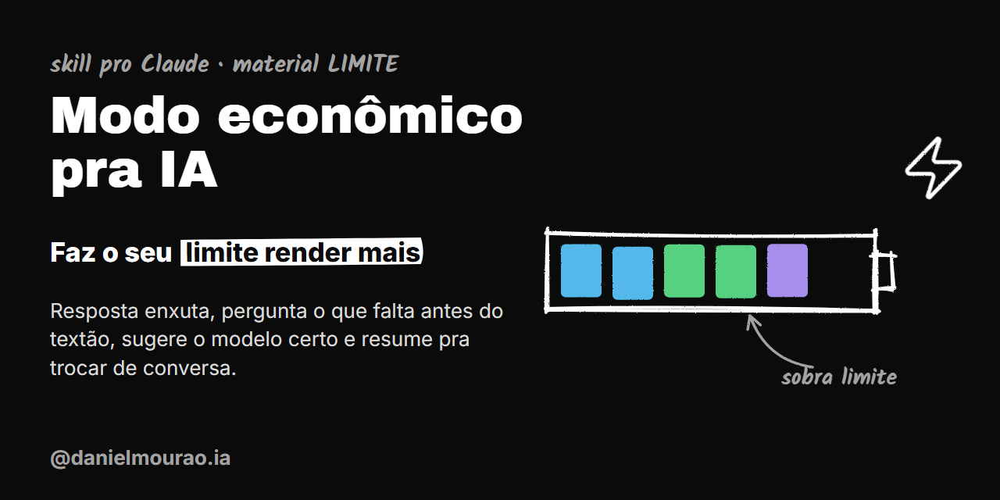
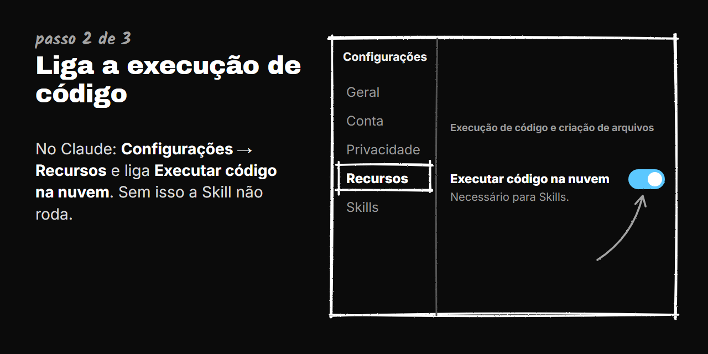
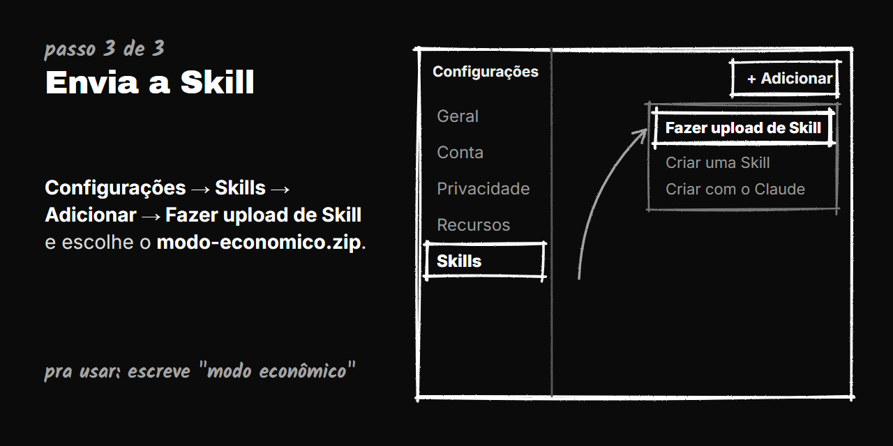

  

  
  
  

  Skill pro <b>Claude</b> que faz o seu limite render mais. 
  Parte do material <b>LIMITE</b> do <a href="https://www.tiktok.com/@danielmourao.ia">@danielmourao.ia</a>.

---

## O que ela faz

| | |
|---|---|
| **Resposta enxuta** | Sem introdução, sem repetir a pergunta, sem resumo no fim. |
| **Pergunta antes do textão** | Até 3 perguntas sobre o que falta, antes de escrever algo longo. |
| **Modelo certo** | Sugere rápido, dia a dia ou mais forte pra cada tarefa. |
| **Troca de conversa** | Faz um resumo de 5 linhas pra você abrir conversa nova sem perder nada. |

## Como instalar (Claude pago)

**1. Baixa o arquivo `modo-economico.zip`** deste repositório: clica nele e depois no botão de download.

**2. Liga a execução de código:** no Claude, **Configurações → Recursos** e liga **Executar código na nuvem**.

**3. Envia a Skill:** **Configurações → Skills → Adicionar → Fazer upload de Skill** e escolhe o `modo-economico.zip`.

**Pra usar:** escreve "modo econômico" ou "resume pra trocar de conversa".

> A Skill entra quando o pedido combina com ela, não em toda conversa. Pra valer sempre, cola também o texto do modo econômico nas instruções fixas do Claude (**Configurações → Conta → Instruções para o Claude**).

## Sem plano pago?

Usa o texto do **modo econômico** (página 12 do material) nas instruções fixas do seu app. Funciona no ChatGPT, no Claude e no Gemini.

## O que tem aqui

| Arquivo | O que é |
|---|---|
| `modo-economico/SKILL.md` | A Skill. Texto puro, sem código e sem acesso à internet. |
| `modo-economico.zip` | A mesma Skill empacotada pra enviar no Claude. |
| `assets/` | Imagens deste README. |

---

  Menus conferidos no Claude em português em 17/11/26. Nomes de menu mudam: se não achar, procura "Skills" nas Configurações. 
  Segue <a href="https://www.tiktok.com/@danielmourao.ia"><b>@danielmourao.ia</b></a> pra mais.

